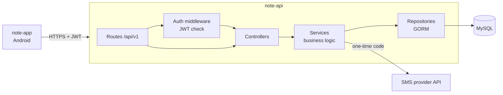
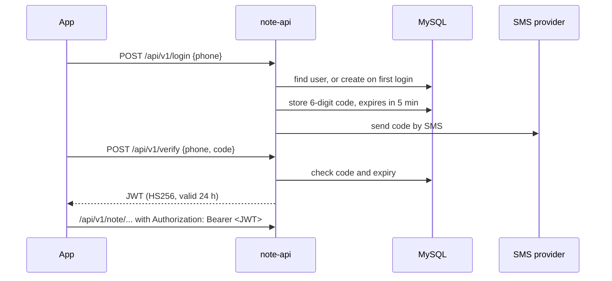

# note-api

Backend for a note-taking app, written in Go with Fiber and GORM on MySQL. You sign in with your phone number and a one-time SMS code, get a JWT, and use it to manage your own notes.

It is the server side of [note-app](https://github.com/Babakkamali/note-app), an offline-first Android client. I built both as a university project in September 2023.

## Architecture



The code is layered, and each layer only calls the one below it:

| Layer | Folder | Responsibility |
|---|---|---|
| Routes | `routes/` | Maps URLs to handlers and wires the dependencies together with constructor injection |
| Middleware | `middleware/` | Validates the `Bearer` JWT and puts the user ID on the request context |
| Controllers | `controllers/` | Parses requests, sets status codes and returns one JSON response shape. The note owner is taken from the JWT, so a client can't write notes for another user by changing the request body. |
| Services | `services/` | Sign-up and sign-in rules, code generation and expiry |
| Repositories | `repository/` | Database access through GORM; note queries are scoped to `user_id` |
| Models | `models/` | `User`, `AuthToken`, `Note` (soft delete via `DeletedAt`) |

## Authentication flow



Login and registration are the same request. A phone number the API hasn't seen before creates a new account.

## API

| Method | Path | Auth | Description |
|---|---|---|---|
| `GET` | `/health` | No | Liveness check, also used by the Docker `HEALTHCHECK` |
| `POST` | `/api/v1/login` | No | Request an SMS code (creates the user if new) |
| `POST` | `/api/v1/verify` | No | Exchange phone + code for a JWT |
| `POST` | `/api/v1/note/` | JWT | Create a note |
| `GET` | `/api/v1/note/` | JWT | List your notes |
| `GET` | `/api/v1/note/:id` | JWT | Get one note |
| `PATCH` | `/api/v1/note/:id` | JWT | Update a note |
| `DELETE` | `/api/v1/note/:id` | JWT | Delete a note (soft delete) |

## Running it

You need Docker with Compose.

```bash
cp .env.example .env        # fill in MySQL settings, JWT_SECRET and the SMS API key
docker compose -f docker-compose.dev.yml up --build
```

The API listens on `http://localhost:8000`, and MySQL is exposed on port `3307` so you can inspect the data. The app container waits for MySQL's health check before it starts, and GORM `AutoMigrate` creates the schema on startup.

The image is a multi-stage build. Go compiles a static binary in the `golang` image, and the binary ships in `alpine` with a container health check on `/health`.

`docker-compose.yml` is the deployment variant. It uses a pre-built image and an external network and volume.

## What I'd do differently today

This is a student project from 2023. Looking at it now, these are the parts I'd change.

- The Dockerfile copies `.env` into the image. Config should come from the environment or a secret store at runtime.
- `/login` sends a paid SMS with no limit per phone number or IP, which is an abuse and cost risk in production.
- One-time codes are stored in plain text. They should be hashed, usable once, and locked after a few failed attempts.
- `dgrijalva/jwt-go` is unmaintained. I'd move to `golang-jwt/jwt` and add refresh tokens and revocation.
- `/health` always returns OK. A readiness check should also ping the database.
- `AutoMigrate` on startup is fine for a prototype, but versioned migrations are safer once the data matters.
- There are no automated tests. I'd start with unit tests for the services and a CI pipeline to run them.
